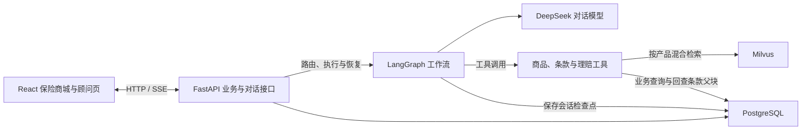

# AI 保险顾问

面向在线保险商城的 AI 顾问演示项目。用户可以在同一个对话中查询保险条款、按需求生成保障方案，以及查看名下保单和理赔进度。用户可以展开回答引用的条款片段，也可以预览方案并决定是否保存。保费试算、订单和投保使用本地演示数据。

## 系统架构



| 层级 | 技术 | 在项目中的职责 |
| --- | --- | --- |
| 前端 | React、TypeScript、Ant Design、Vite | 展示商品和会话，逐段渲染回复，并展示条款来源和方案确认卡片 |
| 接口 | FastAPI、Pydantic、JWT、SSE | 校验请求和会话归属，提供业务 API，将对话结果按事件类型推送给前端 |
| Agent | LangGraph、LangChain、DeepSeek | 结合对话上下文判断意图，编排顾问工作流，由模型按需调用业务工具 |
| 知识库 | MinerU、Ollama、Milvus、DashScope | 解析 PDF，通过本地模型生成向量，结合 BM25 检索并使用语义模型重排 |
| 数据 | PostgreSQL、SQLAlchemy、`AsyncPostgresSaver` | 保存业务数据、条款父块与 LangGraph 会话检查点 |

## 一次对话怎么走

1. **接收请求。** 登录后，前端通过 `POST /api/v1/chat` 提交 `thread_id` 和消息。后端校验用户身份与会话归属，按 `thread_id` 读取 LangGraph 检查点。
2. **识别意图。** 简单寒暄由规则直接回复。其余请求结合上一轮工作流和最近一条可展示的回复，由模型输出结构化意图，再进入保险咨询与方案推荐、理赔咨询、闲聊、转人工提示或兜底分支。
3. **查询并回复。** 保险顾问可查询候选商品、检索条款或提出方案。理赔顾问用当前账号查保单和案件，必要时检索对应产品的条款，提供材料或办理指引。
4. **流式展示结果。** FastAPI 用 SSE 发送 `message` 文本、`additional_info` 结构化数据和 `interrupt` 待确认状态，分别用于逐段展示回复、渲染商品或条款来源，以及显示方案确认卡片。`done` 标记本轮结束。

代码入口见 [LangGraph 编排](agent-service/app/agents/orchestrator.py)、[对话服务](agent-service/app/modules/chat/service.py)和[前端 SSE 客户端](frontend/src/api.ts)。

## 保险条款问答

以「众安尊享 e 生百万医疗险 2026 版的等待期是多久？」为例，顾问先确定对应产品，再检索该产品的条款。知识库分两步工作。

1. **离线建库。** MinerU 将 PDF 解析为 Markdown，DeepSeek 整理标题层级。系统按 Markdown 标题切分父块，保留文件名、章节路径和正文，再从父块切出带重叠的短子块。父块存入 PostgreSQL，子块带 `product_id` 和 `parent_id` 写入 Milvus。Ollama 的 `qwen3-embedding:0.6b` 生成稠密向量，Milvus 对中文文本建立 BM25 检索索引。
2. **在线查询。** Milvus 按 `product_id` 限定范围，用稠密向量匹配语义、用 BM25 匹配关键词，再用 DashScope 的 `gte-rerank-v2` 重排。服务按候选子块的排序对 `parent_id` 去重，从 PostgreSQL 回查父块。小块便于匹配具体问题，父块为模型补回所在章节的上下文。

条款工具把来源编号、文件名、章节路径和检索片段交给顾问。回答可以附上引用编号，用户点击后可核对对应片段。

代码入口见 [文档导入流程](agent-service/app/rag/pipeline.py)、[混合检索与重排](agent-service/app/rag/retriever.py)和[条款查询工具](agent-service/app/agents/tools.py)。

## 保障方案如何确认和保存

1. 顾问收集保障需求和预算，按险种及保费参考条件查找在售商品。方案引用数据库中的产品 ID，后端复核产品后生成预览。
2. 保存工具调用 LangGraph 的 `interrupt()` 暂停执行。PostgreSQL 记录待确认状态，前端收到 SSE 事件后显示预览。刷新页面时，历史接口会一并返回仍待确认的方案。
3. 用户提交确认或拒绝后，后端核对会话与中断状态，用 `Command(resume=...)` 从原检查点恢复。拒绝时结束本次保存，确认时把方案与明细写入 PostgreSQL。
4. 同一次工具调用使用由用户、会话和工具调用 ID 派生的固定方案 ID。数据库利用主键冲突处理，避免同一次确认在重试时重复创建方案。

代码入口见[方案确认工具](agent-service/app/agents/plan_tools.py)、[会话历史恢复](agent-service/app/modules/chat_thread/service.py)和[方案写入逻辑](agent-service/app/modules/insurance_plan/repository.py)。

## 本地运行

准备 Python 3.14、uv、Node.js 22 或更新版本，以及 Docker Compose。以下命令以 PowerShell 为例。

### 1. 配置服务

在仓库根目录执行以下命令，再编辑 `agent-service/.env`。

```powershell
Copy-Item agent-service/.env.example agent-service/.env
```

| 配置 | 用途 |
| --- | --- |
| `DEEPSEEK_API_KEY` | 顾问对话、意图识别和条款导入时的 Markdown 整理 |
| `MINERU_TOKEN` | 导入条款时调用 MinerU 解析 PDF 所需的令牌 |
| `JWT_SECRET` | 登录令牌签名，填写至少 32 个字符的随机值 |

条款重排由 Milvus 调用 DashScope。在本地 `deploy/milvus/user.yaml` 的 `credential.dashscope_apikey.apikey` 填写有效密钥，提交到 GitHub 的配置应保留示例值。应用 `.env` 中的 `DASHSCOPE_API_KEY` 可保留为空。

在仓库根目录启动 PostgreSQL、Milvus 及其依赖。

```powershell
docker compose -f deploy/docker-compose.yml up -d --wait
```

### 2. 启动应用

从仓库根目录打开一个后端终端。

```powershell
cd agent-service
uv sync --locked
uv run python -m app.main
```

从仓库根目录打开另一个终端运行前端。

```powershell
cd frontend
npm ci
npm run dev
```

打开[保险商城](http://localhost:5173)，点击「让顾问帮我选」并注册本地账号。后端可通过 [Swagger 接口文档](http://127.0.0.1:8001/docs)查看。

### 3. 导入条款

体验条款问答前，请自行准备所有示例商品对应的条款 PDF，并按 `products.clause_name` 中的文件名放入 `agent-service/data/raw/kb/`。导入脚本会遍历商品目录，商品及对应文件名见 [PostgreSQL 初始化脚本](deploy/postgres/init/01-init-biz-schema.sql)。

启动本机 Ollama，从仓库根目录执行以下命令。

```powershell
ollama pull qwen3-embedding:0.6b
cd agent-service
uv run python -m scripts.ingest_rag
```

## 演示用例

| 在顾问页输入 | 观察内容 |
| --- | --- |
| 众安尊享 e 生百万医疗险 2026 版的等待期是多久？ | 导入条款后，查看回答中的来源编号并展开核对条款片段 |
| 我 30 岁、是办公室职员，想配医疗险和意外险，年预算 1000 元，请生成一份方案。 | 查看候选商品与方案预览，刷新页面后继续确认，再查看已保存方案 |
| 查看我的保单。 | 已有演示保单时返回当前账号的保单。新注册账号会先看到无记录提示，可从已保存的方案体验模拟投保后再查 |

## 项目目录

| 目录 | 内容 |
| --- | --- |
| [`frontend/src`](frontend/src) | 商城、顾问对话、方案卡片与模拟投保页面 |
| [`agent-service/app/agents`](agent-service/app/agents) | 意图路由、顾问工作流和工具定义 |
| [`agent-service/app/modules`](agent-service/app/modules) | 登录认证、会话、商品、方案、保单和理赔等业务模块 |
| [`agent-service/app/rag`](agent-service/app/rag) | 条款解析、父子切分、存储与检索 |
| [`agent-service/scripts`](agent-service/scripts) | 知识库导入与接口验证脚本 |
| [`deploy`](deploy) | Docker Compose、Milvus 配置和 PostgreSQL 初始化脚本 |
